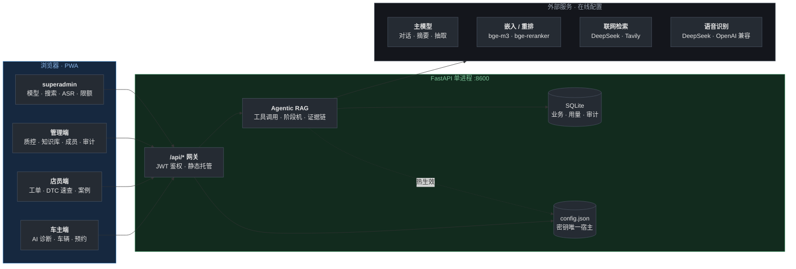

# 新能源汽车 AI 智能诊断系统

面向新能源汽车维修门店的多角色 AI 诊断与预约工单平台。

**版本 2.1.0** · Windows / Linux · Python 3.10+ · Node.js 18+ · MIT

[English](README_EN.md) | 中文

## 背景与定位

1.0 是浏览器直连模型的纯前端原型；2.1 重构为前后端一体的服务端 Agentic RAG 系统：一个 Python 进程同时提供 `/api/*` 与前端页面，SQLite 承载业务数据、向量索引与全文索引，换机器只需拷贝目录。

系统按角色分为四端：车主描述故障，获得结构化诊断卡并一键预约；店员在工单队列中接单、改约、回填维修结果并沉淀案例；管理员负责诊断质控、知识库、成员、统计与审计；部署者通过独立的 superadmin 后台在线维护模型、搜索、语音识别与限额。

在线演示：<https://nev.evoidngc.top>（初始密码 = 账号名）

| 账号 | 角色 |
|---|---|
| `user001` | 车主 |
| `staff001` | 店员 |
| `admin` | 管理员 |

| 车主端诊断对话 | superadmin 调试后台 |
|---|---|
|  |  |

更多文档：[技术架构设计](docs/技术架构设计.md) · [操作指南](docs/操作指南.md) · [CHANGELOG](CHANGELOG.md)

## 特性

**Agentic 诊断**
模型自主调用知识库检索、DTC 查询、联网核实、车辆档案读取与追问工具。诊断阶段（接诊 → 假设 → 验证 → 结论）与证据编号（E1、E2…）随会话落库，管理员可复核「假设 ↔ 证据」映射。支持浏览器录音转文字，识别结果只回填输入框，不落盘。

**检索与知识库**
内置 300+ 条知识（195 条 OBD-II 码表 + 105 条三电知识），按文档结构分块。bge-m3 向量召回后由云端重排模型精排；向量服务不可用或零召回时自动降级为 BM25 关键词检索。检索质量由 50 例评测闸门守护（top-3 命中率 100%）。

**业务闭环**
诊断卡一键预约 → 店员接单/改约 → 回填维修结果 → 沉淀门店案例 → HTML 打印报告。状态机约束流转，新单 30 秒轮询提醒；车主可决定是否允许工作人员查看对话原文。

**四端界面**
17 条路由共用应用外壳、侧栏、顶栏与移动底栏，360–1440 五档宽度适配；深色座舱风、打印浅色主题、跟随系统/浅色/深色三档主题；PWA 可添加到主屏幕，保留键盘焦点与 44px 触控目标。

**管理与运维**
管理员端提供诊断质控、知识库管理与检索测试台、成员角色、统计看板与审计日志。superadmin 后台在线配置主模型（含 aux key）、嵌入、重排、联网搜索、ASR、限额与 Agent 参数，保存即热生效，Key 单向掩码。搜索与 ASR 调用记录次数、时长与人民币成本估算，可按用户或全局设置每日限额，默认不限制。

**安全与隐私**
JWT 四角色接口级鉴权（owner / staff / admin / superadmin）、PBKDF2-SHA256 密码哈希、登录失败限速、CSP 与安全响应头、上传体积与类型限制。诊断摘要卡始终对店员可见；对话原文只在车主开启「工作人员可见我的对话记录」后可见，未授权时 API 层脱敏并写审计。

## 架构与目录



单进程同时提供 API 与页面；数据库、向量索引与全文索引都在 SQLite 内，不依赖外部中间件。模型、嵌入、重排、搜索与 ASR 均为可替换的外部服务：任一环节不可用只降级对应能力，主流程不中断。

### 目录结构

```text
main.py                  启动入口（--host / --port / --reset-superadmin）
backend/
  config.py              配置加载、schema 迁移、原子写
  security.py            PBKDF2 密码哈希与 JWT
  app.py                 应用工厂（CORS、安全头、SPA 托管）
  api/                   认证、对话 SSE、预约、车辆、知识库、DTC、ASR、统计、审计、superadmin
  core/
    agent/               Agent 循环、阶段机、证据链、压缩、抽取
    providers/           主模型、联网搜索、语音识别
    tools/registry.py    工具注册表（kb_search / dtc_lookup / web_search / 车辆档案）
    quota.py             搜索/ASR 限额与用量
  rag/                   向量检索、BM25、重排、分块入库、评测闸门
  seed/                  演示账号、演示车辆、内置知识库
frontend/                Vue 3 + TypeScript + Vite + Element Plus（17 路由）
tests/                   pytest 回归（224 例）
docs/                    技术架构、操作指南、截图
data/                    运行时生成：config.json / data.db / logs/（不入库）
```

## 安装与配置

环境要求：Python 3.10+（开发验证 3.12）、Node.js 18+。主模型 API 必填；嵌入/重排、联网搜索与 ASR 可选，未配置时对应能力自动降级。

```bash
git clone https://github.com/EVOL233awa/NEV-AI-Diagnostic-System.git
cd NEV-AI-Diagnostic-System
python -m pip install -r requirements.txt
mkdir -p data                 # Windows: mkdir data
# 新建 data/config.json，最小内容见下
cd frontend && npm install && npm run build && cd ..
python -m backend.seed.load_corpus   # 导入内置知识库，可重复执行
python main.py                       # http://127.0.0.1:8600
```

最小 `data/config.json`：

```json
{
  "server": { "host": "127.0.0.1", "port": 8600 },
  "deepseek": {
    "base_url": "https://api.deepseek.com",
    "main_model": "deepseek-chat",
    "main_key": "sk-..."
  }
}
```

- 全部密钥只存在该文件：不进仓库、不下发前端、不写日志；`data/` 已在 `.gitignore`。
- 语义检索推荐接入硅基流动 `BAAI/bge-m3` 与 `BAAI/bge-reranker-v2-m3`（均有免费额度），在 `local_models` 填 `embedding_url`、`embedding_model`、`embedding_key` 与 `rerank_url`、`rerank_model`；也可指向本地 llama.cpp llama-server。留空时检索走 BM25。
- 旧版配置（`small_model`、`deepseek.background_*`、`local_models.subagent_url`、顶层 `tavily`）首次启动自动迁移并备份为 `data/config.json.bak-YYYYmmddHHMMSS`。

### 主要配置项

| 配置项 | 说明 | 默认值 |
|---|---|---|
| `server.host` / `server.port` | 监听地址与端口 | `127.0.0.1` / `8600` |
| `deepseek.base_url` | OpenAI 兼容主模型端点 | `https://api.deepseek.com` |
| `deepseek.main_model` | 对话与辅助任务模型 | `deepseek-flash` |
| `deepseek.main_key` | 主模型 Key | 必填 |
| `deepseek.aux_key` | 压缩/标题/抽取专用 Key | 空（复用 `main_key`） |
| `local_models.embedding_url` / `embedding_model` / `embedding_key` | 向量化服务与模型 | `http://127.0.0.1:11436` / `bge-m3` / 空 |
| `local_models.rerank_url` / `rerank_model` / `rerank_enabled` | 重排服务、模型与开关 | 空 / 空 / `true` |
| `search.provider` | 联网搜索供应商：`deepseek` / `tavily` / `custom` | `deepseek` |
| `search.fallback_to_tavily` | DeepSeek 搜索失败时降级 Tavily | `true` |
| `asr.provider` | 语音识别供应商：`deepseek` / `openai` | `deepseek` |
| `asr.max_seconds` / `asr.max_bytes` | 单次录音时长与体积上限 | `120` / `8388608` |
| `quota.*` | 每用户每日 ASR 秒数、搜索次数、全局每日预算（人民币元） | `null`（不限制） |
| `cors_origins` | 跨源白名单 | 本机与演示域名 |
| `security.jwt_secret` | JWT 签名密钥 | 首次启动自动生成 |
| `superadmin.password` | superadmin 密码 | 首次启动随机生成 |

### 演示账号与首次部署

首次启动自动创建 `user001`（车主）、`staff001`（店员）、`admin`（管理员），初始密码等于账号名；正式部署后请立即通过「设置 → 修改密码」更换（至少 8 位，含字母和数字）。

superadmin 首次启动生成 20 位随机密码；来源为 `generated` 时每次启动都会在终端打印密码，设置固定密码（`--set-superadmin-password` 或环境变量 `NEV_SUPERADMIN_PASSWORD`，环境变量优先）后只打印来源、不回显密码。遗忘时用 `--set-superadmin-password` 重设，或运行 `--reset-superadmin` 按 env > config > 随机值重新应用。

### 部署形态

| 形态 | 做法 |
|---|---|
| 单机 / 店内局域网 | `python main.py --host 0.0.0.0`，放行 TCP 8600 |
| 云服务器 + 域名 | 拷贝项目目录 → `python main.py` → 域名指向服务器（HTTPS → 8600） |

## 行为说明与已知限制

- 当未配置嵌入服务时：知识库检索退化为 BM25 关键词检索，其余功能不变。
- 当重排服务关闭或不可用时：保持向量召回的原序，不中断检索。
- 当未配置 Tavily Key 时：`web_search` 工具自动禁用，其余工具不受影响。
- 当车主未开启「工作人员可见我的对话记录」时：店员与管理员只能看到诊断摘要卡，访问对话原文的接口返回 403。
- 当限额配置为 `null` 或 `0` 时：不限制；填入正数后按日统计，拒绝事件写审计。
- 当外部服务调用失败时：上下文压缩保留最近几轮、搜索回退到 Tavily 或知识库、ASR 失败不阻塞文字输入。

已知限制：

- 知识库未按租户分片，所有租户共享同一份内置知识库；多租户商用前需补隔离。
- 登录限速为单进程内存态，多实例部署需换集中存储。
- 非 WAV 音频的时长由客户端上报，服务端只对 WAV 路径解析时长。
- 公网演示经 Cloudflare 隧道转发到源站 8600；备案完成后切换为 443 直连。

## 测试

```bash
python -m pip install -r requirements-dev.txt
python -m pytest tests/            # 224 passed，全离线临时库，不触碰真实 data/
cd frontend && npm run typecheck && npm run test && npm run build
```

前端 Vitest 11 例覆盖录音状态机与 WAV 编码。后端覆盖分块与检索、上下文压缩、工具调用一致性、证据链、权限矩阵、预约状态流转、隐私门槛、ASR 限额、搜索降级、登录限速、配置迁移与原子写；外部模型调用全部模拟。

## 许可证

[MIT](LICENSE) © 2026 EVOL233awa
