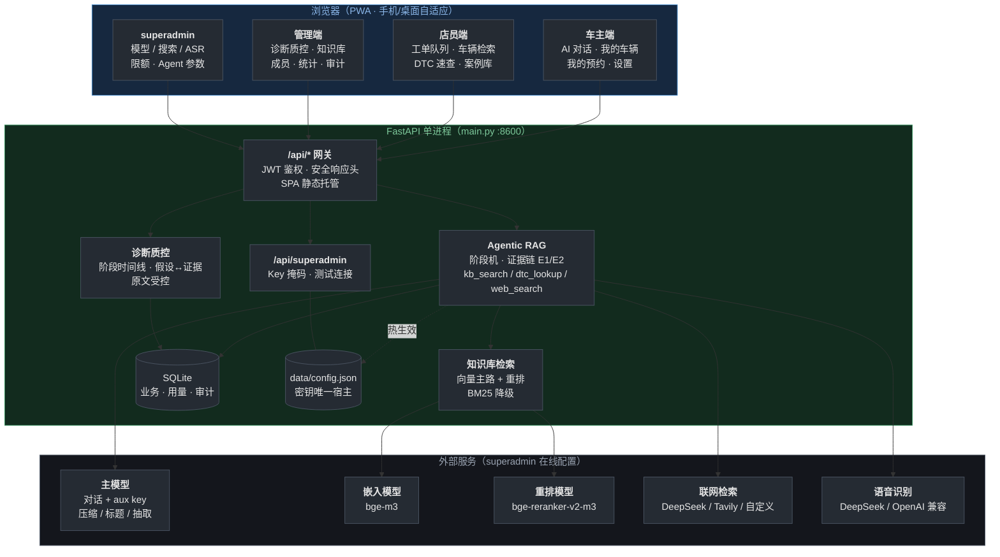
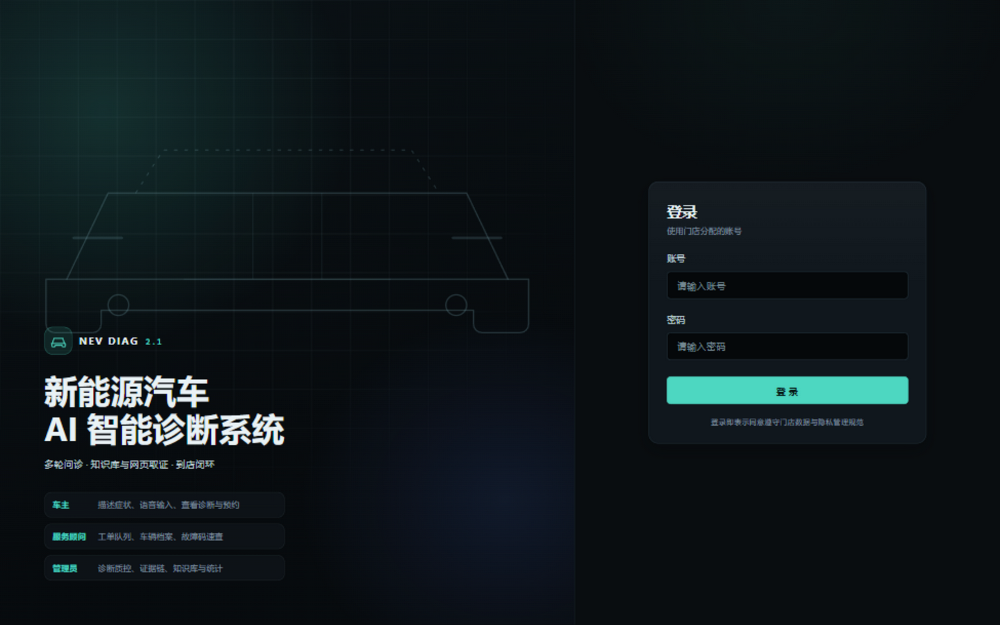
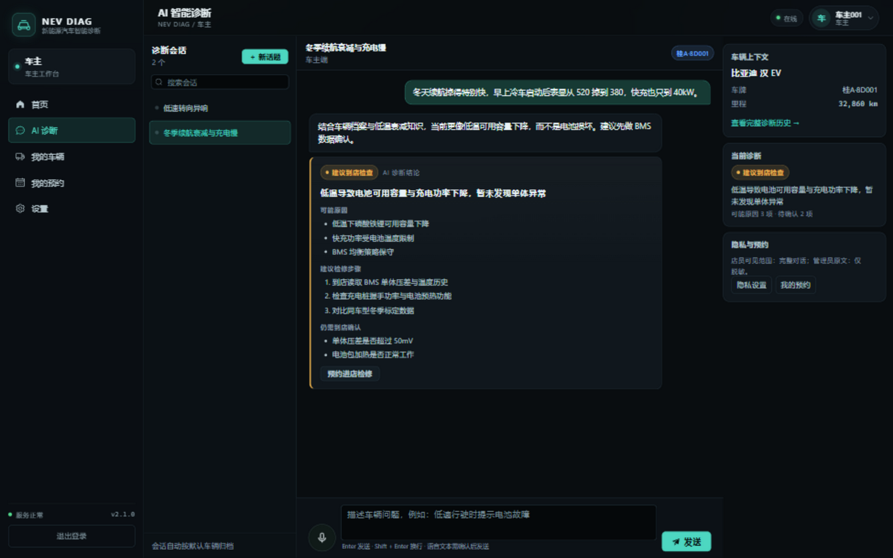
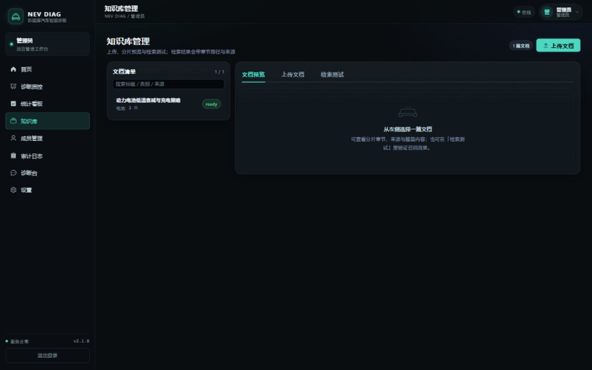
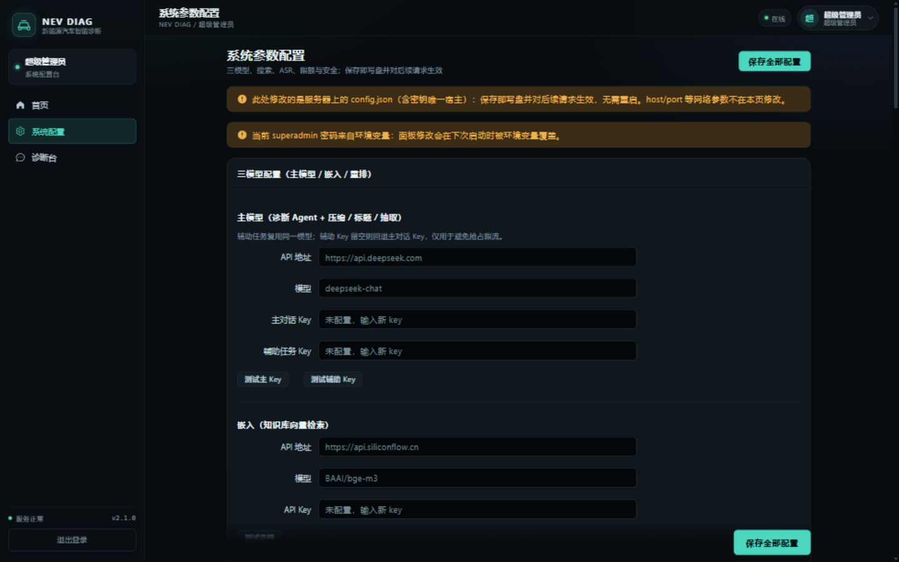

# 新能源汽车 AI 智能诊断系统 2.1

> AI-powered New Energy Vehicle Diagnostic Assistant · 车主 / 店员 / 管理员三端一体的 Agentic RAG 诊断系统 + 部署者专属 superadmin 调试后台

**简体中文** · [English](README_EN.md)

面向新能源汽车维修场景的多角色智能诊断平台：车主通过多轮对话获得结构化诊断结论并一键预约到店；店员在工单闭环中接单、回填、沉淀案例，并用 DTC 速查与车辆档案检索辅助诊断；管理员掌握诊断质控、成员、知识库、统计与审计；部署者另有 superadmin 调试后台，在线运维模型、搜索、ASR 与限额。1.0（纯前端单端工具）的整体重构版本，版本差异详见 [CHANGELOG.md](CHANGELOG.md)。

## 架构总览



系统按**三模型 + 外部服务**运行：主模型（对话；`aux_key` 可让压缩/标题/抽取走独立 Key，不填则复用主 Key）、嵌入模型（知识库语义检索）、重排模型（召回精排）；联网检索与语音识别作为可选外部服务单独配置。三模型槽位与搜索/ASR 供应商均在 superadmin 后台在线配置、保存即热生效。任一环节不可用只降级不中断：压缩失败保留最近几轮，嵌入不可用退化为 BM25 关键词检索，重排不可用保持原序，搜索失败回退 Tavily/知识库，ASR 失败不阻塞文字输入。详细设计见 [技术架构设计文档](docs/技术架构设计.md)。

## 核心特性

- **Agentic 诊断对话**：DeepSeek function calling 驱动 Agent 循环（工具最多 6 轮、每轮最多追问 3 次）；诊断阶段（接诊 → 假设 → 验证 → 结论）与证据编号（E1、E2…）落库，管理员质控可看到“假设 ↔ 证据”映射。
- **Agentic RAG 检索**：文档按结构分段；bge-m3 向量主路 + 云端重排精排，向量不可用/零召回时降级 jieba/BM25 关键词路；内置知识库 300+ 条（OBD-II 码表 195 条 + 三电知识 105 条）。检索质量闸门：50 个典型问题 top-3 命中率 100%，注入故障模式必须显著下降（`python -m backend.rag.eval_gate`）。
- **联网检索供应商**：DeepSeek 官方搜索（动态 `lang:`、域名治理）默认，Tavily（basic/advanced）与自定义 OpenAI 兼容搜索可切换；失败/空结果按配置降级，来源与正文进入证据链。
- **DTC 故障码速查**：店员输入 P0A80/P0562/U0100 等码，精确命中码表定义与知识块；知识库无定义时给出厂商专有码提示。
- **语音输入**：浏览器 16 kHz 单声道 WAV 录音 → `/api/asr/transcribe` → 文本回填输入框（不自动发送）；支持 DeepSeek 官方 ASR 与 OpenAI 兼容接口；不落盘、不记录识别文本。
- **上下文压缩与三层记忆**：超过 20 轮或 token 预算时压缩早期内容；会话诊断状态卡、跨会话车辆档案、店员沉淀案例三层记忆；案例沉淀必须关联已完成工单且车主授权对话可见。
- **预约闭环**：诊断卡一键预约 → 店员接单/改约 → 回填维修结果 → 沉淀案例 → HTML 打印报告（另存 PDF）；状态机约束 + 30s 新单轮询提醒。
- **隐私边界**：诊断摘要卡始终对店员可见；对话原文只在车主开启「工作人员可见我的对话记录」后对店员与管理员可见（后端 403 强制）；未授权时 API 层脱敏并写审计。
- **用量与限额**：搜索/ASR 每次调用写 `usage_stats`（次数、时长、成本估算，人民币计价）；superadmin 可配置每用户每日搜索次数、ASR 秒数、全局每日预算（元），默认三项 `null` 不限制；限额拒绝也写审计。
- **C HMI 设计系统**：17 条路由统一 AppShell / 侧栏 / 顶栏 / 移动底栏，五档宽度（360/390/768/1024/1440）无横向溢出；深色座舱风、打印浅色主题、键盘焦点与 44px 触控目标。
- **安全与审计**：JWT 四角色接口级鉴权、PBKDF2 密码哈希、登录限速、CSP/安全响应头、上传体积上限、config 原子写；登录、建号、改角色、预约流转、隐私变更、案例沉淀、管理员查看原文、ASR/搜索限额拒绝等写审计。

## 功能演示

登录页按角色分流进入车主 / 店员 / 管理员 / 超级管理员四端：



车主端 Agentic 诊断对话：工具调用时间线、结构化诊断卡、证据链与一键预约：



管理端知识库检索测试台：命中结果标注来源（向量 / 关键词）与得分：



superadmin 调试后台（仅部署者）：主模型 / 嵌入 / 重排、搜索、ASR、限额与 Agent 参数在线配置，Key 单向掩码：



## 在线体验

阿里云 ECS + Cloudflare 隧道同源直达（FastAPI :8600）：

https://nev.evoidngc.top

演示账号（初始密码 = 账号名）：user001（车主）· staff001（店员）· admin（管理员）

各端完整操作说明见 [操作指南](docs/操作指南.md)。

## 快速开始

环境要求：Python 3.10+（开发验证于 3.12）、Node.js 18+；推荐注册硅基流动接入免费嵌入/重排模型，也可用本地 llama.cpp llama-server 或全部留空运行（语义检索退化为关键词检索、抽取回退主模型）。

```bash
# 1) 后端依赖
python -m pip install -r requirements.txt

# 2) 配置：创建 data/config.json（含密钥，不进仓库；模板见下节）

# 3) 前端构建
cd frontend && npm install && npm run build && cd ..

# 4) 启动：自动建表，并创建演示账号和演示车辆
python main.py                # http://127.0.0.1:8600
python main.py --host 0.0.0.0 # 店内局域网直连

# 5) 导入内置知识库（300+ 条，按标题自动去重，可重复执行）
python -m backend.seed.load_corpus
```

开发模式：后端 `python main.py --reload`，前端 `cd frontend && npm run dev`（vite 代理 `/api` → 8600）。
测试依赖：`python -m pip install -r requirements-dev.txt`。

### data/config.json 模板（schema v2）

```json
{
  "_meta": { "schema_version": 2 },
  "server": { "host": "127.0.0.1", "port": 8600 },
  "deepseek": {
    "base_url": "https://api.deepseek.com",
    "main_model": "deepseek-chat",
    "main_key": "<你的 DeepSeek API Key>",
    "aux_key": "<可选：压缩/标题/抽取专用 Key，留空复用 main_key>"
  },
  "local_models": {
    "embedding_url": "https://api.siliconflow.cn",
    "embedding_model": "BAAI/bge-m3",
    "embedding_key": "<你的硅基流动 API Key>",
    "rerank_url": "https://api.siliconflow.cn",
    "rerank_model": "BAAI/bge-reranker-v2-m3",
    "rerank_enabled": true,
    "rerank_score_threshold": 0.0
  },
  "search": {
    "provider": "deepseek",
    "fallback_to_tavily": true,
    "fallback_on_empty": false,
    "count": 5,
    "content_max_chars": 1200,
    "deepseek": {
      "base_url": "https://api.deepseek.com",
      "need_content": true,
      "dynamic_language": true,
      "timeout": 20
    },
    "tavily": {
      "api_key": "<可选：Tavily API Key>",
      "search_depth": "basic",
      "max_results": 5,
      "timeout": 20
    },
    "custom": { "base_url": "", "api_key": "", "timeout": 20 }
  },
  "asr": {
    "provider": "deepseek",
    "max_seconds": 120,
    "max_bytes": 8388608,
    "deepseek": { "base_url": "https://api.deepseek.com", "timeout": 60 },
    "openai": { "base_url": "", "model": "", "api_key": "", "timeout": 60 }
  },
  "quota": {
    "asr_daily_seconds_per_user": null,
    "search_daily_calls_per_user": null,
    "global_daily_cny": null
  },
  "cors_origins": ["https://nev.evoidngc.top", "http://127.0.0.1:8600"],
  "security": { "jwt_secret": "<首次启动自动生成；也可手工填>" },
  "superadmin": { "password": "", "password_source": "generated" },
  "agent": {}
}
```

- 全部 API Key 只存该文件：**不进仓库、不下发前端、不写日志**；`data/` 已在 `.gitignore`。
- **推荐接入硅基流动（免费模型，检索链路 API 账单为 0）**：`BAAI/bge-m3` 向量化（1024 维）与 `BAAI/bge-reranker-v2-m3` 重排均在免费额度内；本地部署可改填 llama.cpp llama-server（如 `http://127.0.0.1:11436`）。
- `deepseek.aux_key` 为空时压缩/标题/抽取复用 `main_key`；填入独立 Key 可隔离后台任务限流。
- 搜索供应商：`deepseek`（默认，官方搜索）/ `tavily` / `custom`；`fallback_to_tavily` 在 DeepSeek 不可用时自动降级。Tavily Key 缺失或失效时 `web_search` 工具自动禁用，其余功能不受影响。
- ASR 供应商：`deepseek`（WAV/Ogg）或 `openai`（OpenAI 兼容，webm/mp3/m4a/wav/ogg 由上游决定）。浏览器默认把录音转成 16 kHz 单声道 WAV。
- 限额三项 `null`/`0` = 不限制；填正数才生效，清空立即恢复。演示环境默认不限额，长期公网运行建议设置。
- `cors_origins` 可选，缺省白名单见 `backend/config.py`；同源部署无需配置。
- 旧版 `small_model` / `deepseek.background_*` / `top-level tavily` / `local_models.subagent_url` 会在首次启动时自动迁移并备份为 `data/config.json.bak-YYYYmmddHHMMSS`；迁移写盘为原子替换，失败不会破坏旧文件。

### 演示账号与首次部署

首次启动自动创建三种角色演示账号，仅为演示便利：

> ⚠️ 正式部署后请立即让各账号通过「设置 → 修改密码」更换初始密码。改密码接口强制强度校验（至少 8 位、须含字母和数字、不得包含账号名），且改密码通道不允许回退到「密码 = 账号名」的弱口令。

### superadmin 调试后台

首次启动自动创建 `superadmin` 账号，20 位随机字母数字密码；**仅在首次生成时打印到后端终端**，之后从 config 读取不再回显。明文只存服务器本机 `data/config.json` 的 `superadmin` 节——与 API Key 同一密钥宿主，不进仓库、不进数据库、不出现在任何接口响应中；admin 成员管理对其不可见、不可改。登录后进入 `/superadmin` 配置页，可在线修改：

- **模型供应商**：主模型（含 `aux_key`）、嵌入、重排三个槽位的 API 地址、模型、Key（Key 单向掩码，留空即不修改），重排开关与分数阈值；每个槽位有「测试连接」。
- **联网检索**：DeepSeek / Tavily / 自定义供应商切换、降级开关、结果数与正文长度、各供应商地址/Key/超时；带搜索实测。
- **语音识别**：DeepSeek / OpenAI 兼容供应商切换、`max_seconds`、`max_bytes`、地址/模型/Key/超时。
- **限额**：每用户每日 ASR 秒数、搜索次数、全局每日预算（元）；空/0 = 不限制。
- **Agent 运行参数**：单轮工具轮数、追问上限、回复 token、温度、工具结果截断、压缩双阀门、首轮强制检索。
- **前端接入地址**（仅当前浏览器 localStorage）：留空 = 同源；跨源调试时填写，带测试连接。

除 `server`/`security` 节外全部热生效，无需重启。遗忘密码时在服务器终端运行 `python main.py --reset-superadmin` 重新生成（旧密码立即作废，明文同步写回 config.json）。环境变量 `NEV_SUPERADMIN_PASSWORD` 优先于 config；env/config 来源的密码不在启动日志显示。

### 生产重置

演示期产生的业务数据全部存于 `data/data.db`，上生产前删库重建：

```bash
rm data/data.db                     # Windows: del data\data.db
python main.py                      # 重建数据表 + 演示账号 + 演示车辆
python -m backend.seed.load_corpus  # 重新导入内置知识库（自动去重）
```

## 部署形态

| 形态 | 做法 | 适用 |
|---|---|---|
| 单机 / 店内局域网 | `python main.py --host 0.0.0.0`，放行防火墙 TCP 8600 | 店内日常使用 |
| **云服务器 + 域名（当前采用）** | 云服务器拷贝项目目录 → `python main.py` → 域名解析指向服务器（HTTPS → 8600）；前后端同源，访问域名即进入系统 | 公网演示 / 正式商用 |

后端是纯编排层，不承载模型算力：主模型 / 嵌入 / 重排与搜索/ASR 全部指向 OpenAI 兼容或官方 API；后端进程内存占用不足百 MB，最低配云服务器或家用电脑即可承载；本地 llama.cpp llama-server 自托管只是可选形态。所有槽位地址均在 superadmin 后台在线可配，切换供应商不改代码。

## 安全设计

- **密钥**：全部后端配置管理（1.0 为前端明文 localStorage，已移除）；前端构建产物零密钥；config 写入使用临时文件 + `os.replace` 原子替换，失败保留旧文件。
- **认证**：PBKDF2-SHA256（240k 迭代）密码哈希 + JWT（7 天）；owner / staff / admin / superadmin 四角色接口级鉴权（superadmin 仅部署者，接口独立成组且对 admin 完全隔离）。
- **登录限速**：按账号失败计数，15 分钟窗口内 5 次失败即临时锁定；成功登录清零；锁定事件写审计。单进程内存实现，多实例商用需换集中存储。
- **隐私**：车主对话原文受单一授权开关 `privacy_share_dialog` 控制，店员与管理员共用；未授权时 API 层脱敏。案例沉淀要求已完成工单 + 车主授权，防止绕过隐私开关把原文写入共享知识库。
- **安全响应头**：CSP（`script-src 'self'`、`frame-ancestors 'none'`、`object-src 'none'`）、`X-Content-Type-Options`、`X-Frame-Options`、`Referrer-Policy`、`Permissions-Policy`；HTTPS 下追加 HSTS。跨源 API base 支持 HTTPS 与本地回环。
- **上传**：KB 单文件 20 MiB / 文本 2,000,000 字符上限；ASR 8 MiB 上限 + magic bytes 类型校验；两者均不落盘。
- **审计**：登录成功/失败/锁定、建号、停用、重置密码、预约流转、隐私变更、案例沉淀、管理员查看诊断、ASR/搜索限额拒绝等写 `audit_logs`。

## 测试

```bash
python -m pytest tests/    # 222 例，全离线临时库，不触碰真实 data/
cd frontend && npm run typecheck && npm run build
cd frontend && npm run test   # Vitest 11 例（WAV 编码 / 录音状态机）
```

覆盖：知识库分块与检索、上下文压缩、Agent 对话历史与工具调用一致性、证据链、接口权限矩阵、预约状态流转、案例隐私门槛、ASR 时长/配额/类型、搜索降级、成员管理、登录限速、密码强度、配置迁移与原子写、诊断状态卡抽取与标题生成（外部模型调用全部模拟，完全离线）。

## 目录结构

```text
main.py                  启动入口（--host / --port / --reset-superadmin）
backend/
  config.py              配置加载 / schema v2 迁移 / 原子写
  security.py            PBKDF2 密码哈希 + JWT
  app.py                 应用工厂（CORS + 安全头 + 静态托管 + SPA fallback）
  db/                    SQLAlchemy 模型 + 轻量迁移
  api/                   auth · chat（SSE）· cases · appointments · vehicles
                         · kb · admin_users · admin_diagnosis · dtc · asr
                         · stats · superadmin · system
  rag/                   embedder / vecstore / bm25 / ingest / retrieve / reranker / eval_gate
  core/
    providers/           llm · search（deepseek/tavily/custom）· asr（deepseek/openai）
    tools/registry.py    工具注册表（kb_search / dtc_lookup / web_search / 车辆档案）
    agent/               runner（阶段机/证据链）· compressor · extractor
    quota.py             搜索/ASR 限额与用量
    pricing.py           成本估算
  seed/                  演示账号 + 演示车辆 + 内置知识库（corpus/）
frontend/                Vue 3 + TypeScript + Vite + Element Plus（17 路由）
tests/                   pytest 回归套件（222 例）
data/                    运行时生成：config.json / data.db / logs/（不入库）
```

## 已知限制

- 检索索引未按租户分片（当前所有租户共享同一份内置知识库），多租户商用前需处理；KB 管理/DTC 案例的租户隔离同样待补。
- 登录限速为单进程内存态，多实例部署需换集中存储。
- 非 WAV 音频（OpenAI 兼容接口的 webm/mp3/m4a）暂无法服务端解析时长，限额仍依赖客户端上报；浏览器默认 WAV 路径已由服务端解析。
- 重排在当前语料上的增益有限（top3 已 100% 饱和、top1 +4pp），更大语料下的收益需重新评估；配置可一键关闭。
- 前端 dev 依赖仍有少量 high/critical（vitest/tinypool/vue-tsc 链），只影响开发/CI，生产依赖 `npm audit --omit=dev` 为 0。
- 公网形态当前以「域名 + 非标端口（8600）」过渡：部署所用试用实例不满足 ICP 备案条件，备案通过后切回标准 443。
