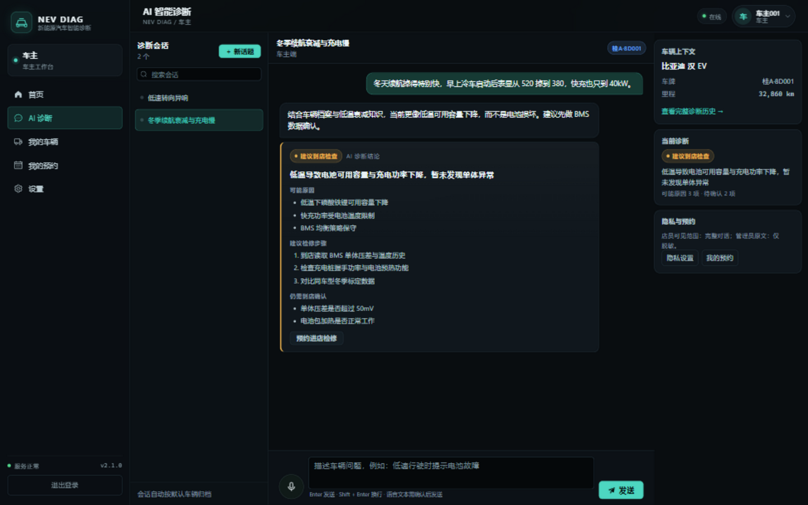
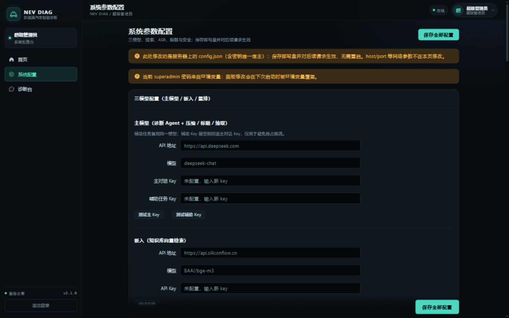
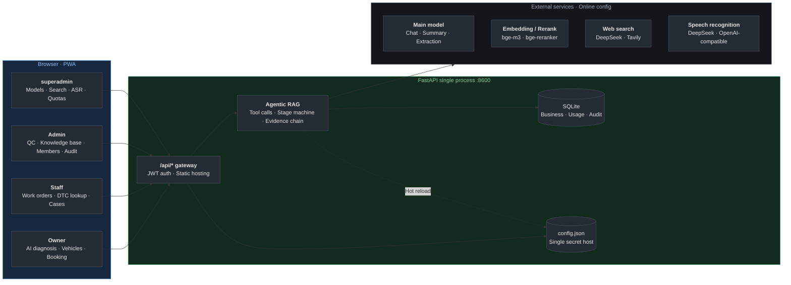

# New Energy Vehicle AI Diagnostic System

A multi-role AI diagnosis and service-booking platform for new energy vehicle repair shops.

**Version 2.1.0** · Windows / Linux · Python 3.10+ · Node.js 18+ · MIT

[中文](README.md) | English

## Background

Version 1.0 was a front-end-only prototype that called the model directly from the browser. Version 2.1 is a full-stack Agentic RAG system: one Python process serves both `/api/*` and the front end, while SQLite stores business data, vector indexes and full-text indexes. Moving to another machine is a directory copy.

The system has four roles: vehicle owners describe a fault and receive a structured diagnosis card with one-click booking; staff accept or reschedule work orders, record repair results and contribute cases; admins handle diagnosis QC, the knowledge base, members, statistics and audit logs; the deployer maintains models, search, speech recognition and quotas through a separate superadmin console.

Online demo: <https://nev.evoidngc.top> (initial password = username)

| Account | Role |
|---|---|
| `user001` | Owner |
| `staff001` | Staff |
| `admin` | Admin |

| Owner diagnosis chat | superadmin console |
|---|---|
|  |  |

More docs: [Technical Architecture](docs/技术架构设计.md) · [User Guide](docs/操作指南.md) · [CHANGELOG](CHANGELOG.md)

## Features

**Agentic diagnosis**
The model autonomously calls knowledge-base search, DTC lookup, web verification, vehicle-profile and follow-up tools. The diagnosis stages (intake → hypothesis → verification → conclusion) and evidence IDs (E1, E2…) are stored with the conversation, so admins can review the hypothesis ↔ evidence mapping. Browser speech-to-text fills the input box only; the result is not persisted.

**Retrieval and knowledge base**
The built-in knowledge base has 300+ entries (195 OBD-II codes and 105 EV knowledge sections), chunked by document structure. bge-m3 vector recall is followed by cloud reranking; if the embedding service is unavailable or returns no results, retrieval falls back to BM25 keyword search. Retrieval quality is guarded by a 50-case evaluation gate (100% top-3 hit rate).

**Service loop**
Diagnosis card → one-click booking → staff accept/reschedule → repair result → store case → HTML printout. A state machine governs transitions, and new orders trigger a 30-second polling reminder. Owners decide whether staff may view the original conversation.

**Four consoles**
17 routes share one app shell, sidebar, top bar and mobile tab bar, with five responsive widths from 360 to 1440. Dark cockpit theme, light print theme, and system/light/dark theme options; PWA install, keyboard focus and 44px touch targets.

**Administration and operations**
Admins get diagnosis QC, knowledge-base management with a retrieval test bench, member roles, statistics and audit logs. The superadmin console configures the main model (including aux key), embeddings, reranking, web search, ASR, quotas and agent parameters online, with hot reload and one-way key masking. Search and ASR usage record calls, duration and estimated cost in CNY; per-user or global daily quotas are optional and unlimited by default.

**Security and privacy**
JWT role-based authorization for four roles (owner / staff / admin / superadmin), PBKDF2-SHA256 password hashing, login failure rate limiting, CSP and security headers, upload size and type limits. The diagnosis summary card is always visible to staff; the original conversation is visible only after the owner enables "Staff can view my conversation", otherwise the API masks it and writes an audit entry.

## Architecture and layout



One process serves both API and pages; business data, vector indexes and full-text indexes all live in SQLite, with no external middleware. The model, embedding, reranking, search and ASR services are replaceable external services: if one is unavailable, only that capability degrades and the main flow continues.

### Directory layout

```text
main.py                  entry point (--host / --port / --reset-superadmin)
backend/
  config.py              config loading, schema migration, atomic writes
  security.py            PBKDF2 password hashing and JWT
  app.py                 app factory (CORS, security headers, SPA hosting)
  api/                   auth, chat SSE, appointments, vehicles, KB, DTC, ASR, stats, audit, superadmin
  core/
    agent/               agent loop, stage machine, evidence chain, compression, extraction
    providers/           main model, web search, speech recognition
    tools/registry.py    tool registry (kb_search / dtc_lookup / web_search / vehicle profile)
    quota.py             search/ASR quotas and usage
  rag/                   vector retrieval, BM25, reranking, chunk ingestion, evaluation gate
  seed/                  demo accounts, demo vehicle, built-in knowledge base
frontend/                Vue 3 + TypeScript + Vite + Element Plus (17 routes)
tests/                   pytest regression suite (224 cases)
docs/                    architecture, user guide, screenshots
data/                    runtime: config.json / data.db / logs/ (not committed)
```

## Installation and configuration

Requirements: Python 3.10+ (developed on 3.12), Node.js 18+. A main-model API key is required; embedding/reranking, web search and ASR are optional and degrade automatically when unconfigured.

```bash
git clone https://github.com/EVOL233awa/NEV-AI-Diagnostic-System.git
cd NEV-AI-Diagnostic-System
python -m pip install -r requirements.txt
mkdir -p data                 # Windows: mkdir data
# create data/config.json, minimal content below
cd frontend && npm install && npm run build && cd ..
python -m backend.seed.load_corpus   # import the built-in KB; safe to rerun
python main.py                       # http://127.0.0.1:8600
```

Minimal `data/config.json`:

```json
{
  "server": { "host": "127.0.0.1", "port": 8600 },
  "deepseek": {
    "base_url": "https://api.deepseek.com",
    "main_model": "deepseek-chat",
    "main_key": "sk-..."
  }
}
```

- All secrets live only in this file: never committed, never sent to the browser, never logged. `data/` is in `.gitignore`.
- For semantic retrieval, SiliconFlow's `BAAI/bge-m3` and `BAAI/bge-reranker-v2-m3` are recommended (both have free tiers). Set `embedding_url`, `embedding_model`, `embedding_key`, `rerank_url` and `rerank_model` under `local_models`; a local llama.cpp llama-server also works. If left empty, retrieval uses BM25.
- Legacy config keys (`small_model`, `deepseek.background_*`, `local_models.subagent_url`, top-level `tavily`) are migrated automatically on first start and backed up to `data/config.json.bak-YYYYmmddHHMMSS`.

### Key configuration

| Key | Description | Default |
|---|---|---|
| `server.host` / `server.port` | Listen address and port | `127.0.0.1` / `8600` |
| `deepseek.base_url` | OpenAI-compatible main-model endpoint | `https://api.deepseek.com` |
| `deepseek.main_model` | Chat and auxiliary-task model | `deepseek-flash` |
| `deepseek.main_key` | Main-model key | required |
| `deepseek.aux_key` | Dedicated key for compression/title/extraction | empty (reuses `main_key`) |
| `local_models.embedding_url` / `embedding_model` / `embedding_key` | Embedding service and model | `http://127.0.0.1:11436` / `bge-m3` / empty |
| `local_models.rerank_url` / `rerank_model` / `rerank_enabled` | Rerank service, model, and switch | empty / empty / `true` |
| `search.provider` | Web search provider: `deepseek` / `tavily` / `custom` | `deepseek` |
| `search.fallback_to_tavily` | Fall back to Tavily when DeepSeek search fails | `true` |
| `asr.provider` | Speech recognition provider: `deepseek` / `openai` | `deepseek` |
| `asr.max_seconds` / `asr.max_bytes` | Per-recording duration and size limits | `120` / `8388608` |
| `quota.*` | Per-user daily ASR seconds, search calls, and global daily budget (CNY) | `null` (unlimited) |
| `cors_origins` | Cross-origin allowlist | local and demo domains |
| `security.jwt_secret` | JWT signing key | generated on first start |
| `superadmin.password` | superadmin password | generated on first start |

### Demo accounts and first deployment

On first start the system creates `user001` (owner), `staff001` (staff) and `admin` (admin); the initial password equals the username. Change it immediately after deployment via Settings → Change password (at least 8 characters, with letters and numbers).

superadmin gets a 20-character random password on first start. When the source is `generated`, the password is printed to the terminal on every start; after setting a fixed password (`--set-superadmin-password` or the `NEV_SUPERADMIN_PASSWORD` environment variable, which takes precedence), only the source is printed and the password is not echoed. To reset, use `--set-superadmin-password`; `--reset-superadmin` re-applies the priority order env > config > newly generated random value.

### Deployment options

| Option | How |
|---|---|
| Single machine / shop LAN | `python main.py --host 0.0.0.0`, allow TCP 8600 |
| Cloud server + domain | Copy the project directory → `python main.py` → point the domain at the server (HTTPS → 8600) |

## Behavior and known limitations

- When no embedding service is configured: knowledge-base retrieval falls back to BM25 keyword search; everything else is unchanged.
- When reranking is disabled or unavailable: vector recall keeps its original order and retrieval continues.
- When no Tavily key is configured: the `web_search` tool is disabled; other tools are unaffected.
- When the owner has not enabled "Staff can view my conversation": staff and admins see only the diagnosis summary card, and API calls for the original conversation return 403.
- When a quota is `null` or `0`: unlimited; a positive value enforces a daily limit and rejected requests are audited.
- When an external service fails: context compression keeps the most recent turns, search falls back to Tavily or the knowledge base, and ASR failure does not block text input.

Known limitations:

- The knowledge base is not tenant-sharded; all tenants share the built-in KB. Tenant isolation is needed before multi-tenant commercial use.
- Login rate limiting is in-process memory; multi-instance deployments need shared storage.
- For non-WAV audio, duration is reported by the client; only the WAV path is parsed server-side.
- The public demo goes through a Cloudflare tunnel to origin port 8600; it will switch to direct 443 after ICP filing.

## Testing

```bash
python -m pip install -r requirements-dev.txt
python -m pytest tests/            # 224 passed, offline temp DB, real data/ untouched
cd frontend && npm run typecheck && npm run test && npm run build
```

The front-end Vitest suite has 11 cases covering the recording state machine and WAV encoding. The back end covers chunking and retrieval, context compression, tool-call consistency, evidence chain, permission matrix, appointment transitions, privacy gate, ASR quotas, search fallback, login rate limiting, config migration and atomic writes; all external model calls are mocked.

## License

[MIT](LICENSE) © 2026 EVOL233awa
