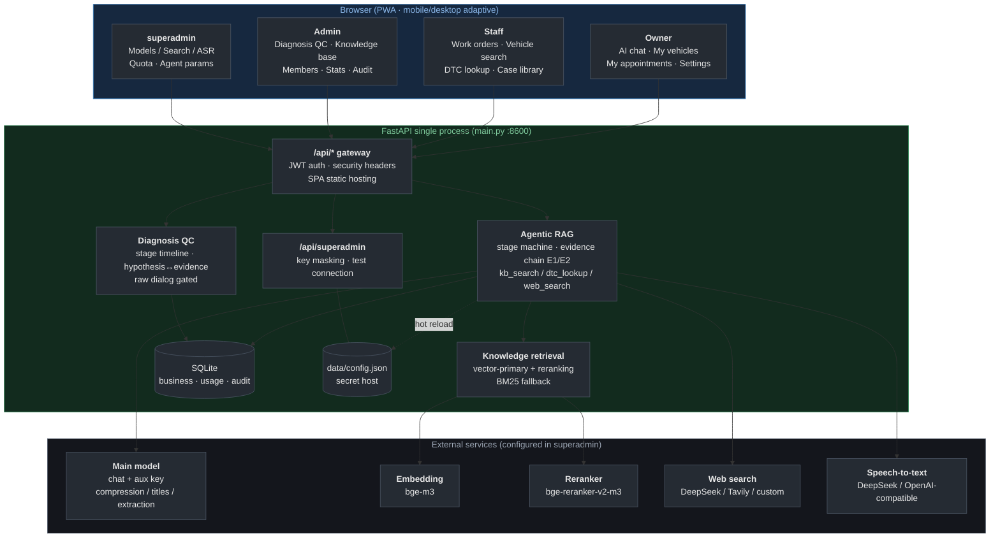
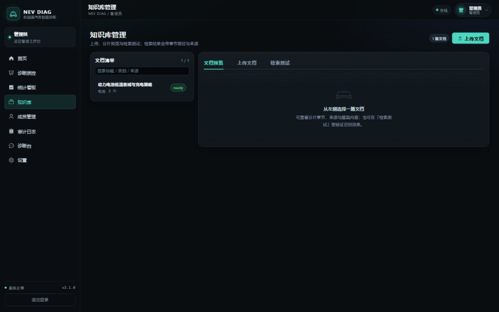

# New Energy Vehicle AI Diagnostic System 2.1

> AI-powered New Energy Vehicle Diagnostic Assistant · A three-role (owner / staff / admin) Agentic RAG diagnostic platform, plus a deployer-only superadmin console

[简体中文](README.md) · **English**

A multi-role intelligent diagnostic platform for new energy vehicle service: owners describe symptoms in multi-turn conversation and get structured diagnostic conclusions with one-click service booking; staff handle the work-order loop — accepting, rescheduling, filling in repair results and contributing cases — with DTC lookup and vehicle history; admins own diagnosis QC, members, knowledge base, statistics and audit logs; the deployer additionally gets a **superadmin console** for online operations on models, search, ASR and quotas. A full-stack rebuild of 1.0 (a pure front-end, single-role tool) — see [CHANGELOG.md](CHANGELOG.md) for version differences.

## Architecture Overview



The system runs on **three models + external services**: main model (chat; `aux_key` optionally isolates compression/title/extraction), embedding model (semantic retrieval), reranker (result refinement); web search and speech-to-text are separately configured optional services. All slots are hot-reloadable from the superadmin console. Every dependency degrades gracefully: compression keeps recent rounds, embeddings fall back to BM25, reranking keeps original order, search falls back to Tavily/knowledge base, ASR failure never blocks text input. See [architecture design (Chinese)](docs/技术架构设计.md) for details.

## Highlights

- **Agentic diagnosis**: DeepSeek function calling drives the agent loop (max 6 tool rounds, max 3 follow-up questions per round); diagnosis stages (intake → hypothesis → verification → conclusion) and evidence keys (E1, E2…) are persisted, so admins can audit hypothesis↔evidence mapping.
- **Agentic RAG**: structure-aware chunking; bge-m3 vector path + cloud reranking, with jieba/BM25 fallback; 300+ built-in knowledge entries; retrieval quality gate (`python -m backend.rag.eval_gate`).
- **Search providers**: DeepSeek official search by default (dynamic `lang:`, domain governance), switchable to Tavily (basic/advanced) or custom OpenAI-compatible search; fallback on failure/empty results.
- **DTC lookup**: staff can query P0A80/P0562/U0100 and get exact code definitions and knowledge chunks, with vendor-specific hints when absent.
- **Voice input**: browser records 16 kHz mono WAV → `/api/asr/transcribe` → text inserted into the composer (never auto-sent); DeepSeek official ASR or OpenAI-compatible endpoints; audio is not persisted and transcripts are not logged.
- **Compression & three-layer memory**: automatic summary for long chats; in-session diagnostic state card, cross-session vehicle profile, staff-contributed cases. Case contribution requires a completed appointment and owner consent.
- **Appointment loop**: diagnostic card → booking → staff accept/reschedule → repair result → case contribution → printable HTML report; state machine enforced; 30s new-order polling.
- **Privacy boundaries**: the diagnostic summary card is always visible to staff; raw dialog is gated by the owner's `privacy_share_dialog` flag (backend 403). Admin raw-dialog access has a separate `privacy_share_admin` flag, default off; API redacts and audits.
- **Usage & quotas**: every search/ASR call writes `usage_stats` (calls, duration, estimated cost); superadmin can set per-user daily search calls, ASR seconds and a global USD budget. All three default to `null` (unlimited). Quota rejections are audited.
- **C HMI design system**: 17 routes share AppShell / side nav / top bar / mobile tab bar; five widths (360/390/768/1024/1440) with zero horizontal overflow; dark cockpit theme, print theme, keyboard focus and 44px touch targets.
- **Security & audit**: JWT role-based authorization, PBKDF2 passwords, login throttling, CSP/security headers, upload limits, atomic config writes; login, account changes, appointment transitions, privacy changes, case contribution, admin diagnosis views and quota rejections are audited.

## Screenshots

Login (role-based routing):


Owner Agentic diagnosis with tool timeline, structured diagnostic card and booking:


Admin knowledge-base retrieval bench with source/score annotations:



superadmin console (deployer only): models, search, ASR, quota and agent parameters with one-way key masking:


## Live Demo

Alibaba Cloud ECS + Cloudflare tunnel (FastAPI :8600, same-origin):

https://nev.evoidngc.top

Demo accounts (initial password = username): user001 (owner) · staff001 (staff) · admin (admin)

See the [operation guide (Chinese)](docs/操作指南.md) for role-by-role walkthroughs.

## Quick Start

Requirements: Python 3.10+ (verified on 3.12), Node.js 18+. SiliconFlow's free embedding/reranker models are recommended; local llama.cpp llama-server works too, and everything can be left empty (retrieval falls back to keywords).

```bash
# 1) Backend dependencies
python -m pip install -r requirements.txt

# 2) Create data/config.json (secrets live only here; template below)

# 3) Build frontend
cd frontend && npm install && npm run build && cd ..

# 4) Start (creates tables, demo accounts and demo vehicle)
python main.py                # http://127.0.0.1:8600
python main.py --host 0.0.0.0 # LAN access

# 5) Import built-in corpus (300+ entries, idempotent)
python -m backend.seed.load_corpus
```

Development: backend `python main.py --reload`, frontend `cd frontend && npm run dev` (Vite proxies `/api` to 8600).
Test dependencies: `python -m pip install -r requirements-dev.txt`.

### data/config.json template (schema v2)

```json
{
  "_meta": { "schema_version": 2 },
  "server": { "host": "127.0.0.1", "port": 8600 },
  "deepseek": {
    "base_url": "https://api.deepseek.com",
    "main_model": "deepseek-chat",
    "main_key": "<DeepSeek API key>",
    "aux_key": "<optional: separate key for compression/titles/extraction>"
  },
  "local_models": {
    "embedding_url": "https://api.siliconflow.cn",
    "embedding_model": "BAAI/bge-m3",
    "embedding_key": "<SiliconFlow API key>",
    "rerank_url": "https://api.siliconflow.cn",
    "rerank_model": "BAAI/bge-reranker-v2-m3",
    "rerank_enabled": true,
    "rerank_score_threshold": 0.0
  },
  "search": {
    "provider": "deepseek",
    "fallback_to_tavily": true,
    "fallback_on_empty": false,
    "count": 5,
    "content_max_chars": 1200,
    "deepseek": { "base_url": "https://api.deepseek.com", "need_content": true, "dynamic_language": true, "timeout": 20 },
    "tavily": { "api_key": "<optional Tavily key>", "search_depth": "basic", "max_results": 5, "timeout": 20 },
    "custom": { "base_url": "", "api_key": "", "timeout": 20 }
  },
  "asr": {
    "provider": "deepseek",
    "max_seconds": 120,
    "max_bytes": 8388608,
    "deepseek": { "base_url": "https://api.deepseek.com", "timeout": 60 },
    "openai": { "base_url": "", "model": "", "api_key": "", "timeout": 60 }
  },
  "quota": {
    "asr_daily_seconds_per_user": null,
    "search_daily_calls_per_user": null,
    "global_daily_usd": null
  },
  "cors_origins": ["https://nev.evoidngc.top", "http://127.0.0.1:8600"],
  "security": { "jwt_secret": "<auto-generated on first start; may be set manually>" },
  "superadmin": { "password": "", "password_source": "generated" },
  "agent": {}
}
```

- API keys live only in this file: not committed, not sent to the frontend, never logged. `data/` is gitignored.
- `deepseek.aux_key` empty → compression/titles/extraction reuse `main_key`; a separate key isolates background-task rate limits.
- Search provider: `deepseek` (default) / `tavily` / `custom`; `fallback_to_tavily` enables automatic fallback.
- ASR provider: `deepseek` (WAV/Ogg) or `openai` (OpenAI-compatible; formats depend on upstream). The browser converts recordings to 16 kHz mono WAV.
- Quota fields `null`/`0` mean unlimited; positive values enable limits, clearing immediately restores unlimited. Demo defaults are unlimited.
- Old `small_model` / `deepseek.background_*` / top-level `tavily` / `local_models.subagent_url` keys are migrated on first start, with a timestamped backup. Writes are atomic.
- See the Chinese README for detailed operational notes.

## Demo Accounts & First Deployment

The first start creates three demo accounts (initial password = username). For any real deployment, change all passwords immediately via Settings → Change Password. The API enforces at least 8 characters with letters and digits and rejects account-name-based passwords.

## superadmin Console

The first start creates a `superadmin` account with a 20-character random password. The password is printed **only when first generated**; subsequent starts read it from config without echoing it. The plaintext lives only in `data/config.json` on the server — never committed, never in the database, never in API responses; invisible and immutable to admins. The console supports:

- **Model providers**: main (with `aux_key`), embedding, rerank; URL/model/key with one-way masking; rerank toggle/threshold; per-slot connection test.
- **Web search**: DeepSeek / Tavily / custom, fallback switches, result count/content length, per-provider URL/key/timeout, live search test.
- **ASR**: DeepSeek / OpenAI-compatible, `max_seconds`, `max_bytes`, URL/model/key/timeout.
- **Quota**: per-user ASR seconds/day, search calls/day, global USD/day; empty/0 = unlimited.
- **Agent parameters**: tool rounds, follow-up limit, max tokens, temperature, tool-result truncation, compression thresholds, forced first-round retrieval.
- **Frontend API base** (current browser localStorage): empty = same origin; used only for cross-origin debugging.

Everything except `server`/`security` is hot-reloadable. Reset a forgotten password with `python main.py --reset-superadmin`. `NEV_SUPERADMIN_PASSWORD` takes precedence over config; env/config-sourced passwords are not printed.

## Deployment

| Mode | How | Use case |
|---|---|---|
| Single machine / LAN | `python main.py --host 0.0.0.0`, allow TCP 8600 | Daily shop use |
| **Cloud + domain (current)** | Copy project to server → `python main.py` → point domain to server (HTTPS → 8600); same-origin | Public demo / production |

The backend is pure orchestration and holds no model compute: main/embedding/rerank models and search/ASR all point to OpenAI-compatible or official APIs; memory footprint is under ~100 MB. Local llama.cpp is optional. All endpoints are configurable in superadmin without code changes.

## Security

- **Secrets**: backend-only config; zero secrets in the frontend build; atomic config writes preserve the old file on failure.
- **Auth**: PBKDF2-SHA256 (240k iterations) + 7-day JWT; owner/staff/admin/superadmin authorization at the API layer; superadmin group isolated from admins.
- **Login throttling**: 5 failures in 15 minutes locks the account temporarily; lock events are audited. Single-process in-memory implementation.
- **Privacy**: owner raw dialog gated by `privacy_share_dialog`; admin raw dialog by `privacy_share_admin` (default off) with API redaction and audit. Case contribution requires a completed appointment and owner consent.
- **Headers**: CSP (`script-src 'self'`, `frame-ancestors 'none'`, `object-src 'none'`), `X-Content-Type-Options`, `X-Frame-Options`, `Referrer-Policy`, `Permissions-Policy`; HSTS on HTTPS.
- **Uploads**: KB 20 MiB / 2,000,000 chars; ASR 8 MiB + magic-byte type checks; neither writes files to disk.
- **Audit**: logins, account changes, appointment transitions, privacy changes, case contribution, admin diagnosis views and quota rejections are recorded.

## Tests

```bash
python -m pytest tests/    # 221 tests, fully offline with a temporary DB
cd frontend && npm run typecheck && npm run build
cd frontend && npm run test   # 11 Vitest tests (WAV encoding / recorder state machine)
```

Coverage includes chunking/retrieval, compression, agent history/tool consistency, evidence chain, authorization matrix, appointment transitions, case privacy gate, ASR duration/quota/type, search fallback, member management, login throttling, password strength, config migration/atomic write, state-card extraction and title generation (all model calls mocked).

## Directory Layout

```text
main.py                  entrypoint (--host / --port / --reset-superadmin)
backend/
  config.py              config loading / schema v2 migration / atomic write
  security.py            PBKDF2 hashing + JWT
  app.py                 app factory (CORS + security headers + SPA hosting)
  db/                    SQLAlchemy models + lightweight migrations
  api/                   auth · chat (SSE) · cases · appointments · vehicles
                         · kb · admin_users · admin_diagnosis · dtc · asr
                         · stats · superadmin · system
  rag/                   embedder / vecstore / bm25 / ingest / retrieve / reranker / eval_gate
  core/
    providers/           llm · search (deepseek/tavily/custom) · asr (deepseek/openai)
    tools/registry.py    tool registry (kb_search / dtc_lookup / web_search / vehicle profile)
    agent/               runner (stages/evidence) · compressor · extractor
    quota.py             search/ASR quotas and usage
    pricing.py           cost estimation
  seed/                  demo accounts + demo vehicle + built-in corpus
frontend/                Vue 3 + TypeScript + Vite + Element Plus (17 routes)
tests/                   pytest suite (221 tests)
data/                    runtime: config.json / data.db / logs/ (gitignored)
```

## Known Limitations

- Retrieval index is not tenant-sharded (all tenants share the built-in corpus); KB management/DTC case tenant isolation is also pending for multi-tenant commercial use.
- Login throttling is in-memory and single-process; multi-instance deployments need shared storage.
- Non-WAV audio (webm/mp3/m4a via OpenAI-compatible ASR) cannot be duration-parsed server-side yet; quotas still rely on the client-reported duration. The browser's default WAV path is server-verified.
- Reranking gains are limited on the current corpus (top3 saturated at 100%, top1 +4pp); reassess on a larger corpus. It can be disabled.
- Frontend dev dependencies still report a few high/critical advisories (vitest/tinypool/vue-tsc chain); production dependencies have 0 (`npm audit --omit=dev`).
- The public deployment currently uses a non-standard port (8600) until ICP filing is complete.
