# 新能源汽车 AI 智能诊断系统 2.1 · 操作指南

> 适用版本 2.1.0 · 面向系统的四类使用者：**车主、店员、管理员与部署者**
> 部署与配置见 [README](../README.md)，架构与设计决策见 [技术架构设计](技术架构设计.md)，版本差异见 [CHANGELOG](../CHANGELOG.md)。

---

## 1. 软件概述

### 1.1 系统简介

新能源汽车 AI 智能诊断系统（V2.1.0）是面向新能源汽车维修服务场景的多角色智能诊断平台。系统以大语言模型驱动的智能诊断对话为核心，融合知识库检索（RAG）、联网核实、故障码速查与车辆档案，为车主提供结构化的故障诊断结论；同时为门店提供从线上诊断到线下服务的完整业务闭环：车主在获得诊断结论后可一键预约到店，店员在工单闭环中接单、改约、回填维修结果并沉淀维修案例，管理员掌握诊断质控、成员、知识库、统计与审计，部署者另可通过专属调试后台在线配置模型、搜索、语音识别与限额。

系统采用前后端一体架构：后端基于 Python FastAPI 框架，单进程同时提供 API 服务与前端页面托管；前端基于 Vue 3、TypeScript 与 Element Plus 构建，采用统一 C HMI 座舱设计系统，支持桌面与手机自适应访问，并支持添加到主屏幕以独立窗口运行。诊断引擎为服务端 Agentic RAG 架构：模型通过工具调用自主检索内置维修知识库（300 余条知识条目）、查询故障码、联网核实、读取车辆档案并向用户追问；检索以向量语义检索为主路、经云端重排模型按相关性精排，关键词检索作为降级保底；诊断阶段与证据编号随会话落库，供管理员质控复核。

### 1.2 主要功能

1. **车主端**：AI 智能诊断对话（多轮交互、工具时间线、受控追问、结构化诊断卡、语音输入）、车辆档案与里程管理、预约管理、隐私设置与密码管理；
2. **店员端**：预约工单处理（接单、改约、回填维修结果）、车辆档案检索与诊断历史、DTC 故障码速查、案例库沉淀、诊断报告打印；
3. **管理端**：诊断质控（阶段时间线、假设↔证据关联、原文受控查看）、知识库管理（上传、分块预览、检索测试）、成员与角色管理、统计看板、审计日志；
4. **部署者调试后台**：主模型（含 aux key）/嵌入/重排、联网检索、语音识别、限额与智能体运行参数在线配置（保存即热生效），密钥单向掩码。

### 1.3 运行环境

- **服务器端**：CPU 2 核及以上，内存 4GB 及以上；操作系统为 Linux 或 Windows；软件环境为 Python 3.10 及以上版本及其中文分词、向量检索等依赖库。
- **客户端**：主流现代浏览器（Chrome、Edge、Safari、Firefox 及同等内核浏览器），支持桌面电脑、平板与手机访问，无需安装插件。
- **外部服务**：需接入 OpenAI 兼容或官方大语言模型服务（诊断对话）；可选接入嵌入/重排模型（未配置时语义检索降级为关键词检索）、联网检索（DeepSeek/Tavily/自定义）与语音识别（DeepSeek/OpenAI 兼容）。以上地址均可在部署者调试后台在线配置。

## 2. 安装与启动

### 2.1 安装步骤

1. 安装 Python 3.10 及以上版本与 Node.js 18 及以上版本。
2. 克隆本仓库，在根目录执行 `python -m pip install -r requirements.txt` 安装后端依赖；需要运行测试时再安装 `requirements-dev.txt`。
3. 创建配置文件 `data/config.json`，填入模型服务地址、模型名称与 API 密钥等配置项（schema v2 模板见 README「快速开始」）。
4. 在 `frontend/` 目录执行 `npm install` 与 `npm run build` 完成页面构建。
5. 在程序根目录执行 `python main.py` 启动服务，系统自动完成数据表创建与演示账号初始化。
6. 执行 `python -m backend.seed.load_corpus` 导入内置维修知识库（300 余条，自动按标题去重）。

完整依赖说明、配置模板与生产部署形态见 [README](../README.md)「快速开始」「部署形态」。

### 2.2 访问系统

- **本机访问**：浏览器打开 `http://localhost:8600`。
- **店内局域网访问**：以 `python main.py --host 0.0.0.0` 启动后，店内电脑或手机浏览器访问 `http://服务器IP:8600`。
- **云服务器部署**：将域名解析指向服务器并配置 HTTPS 后，访问域名即进入系统；在线体验环境见 README「在线体验」。

首次启动自动创建演示账号（初始密码与账号名相同）：`user001`（车主）、`staff001`（店员）、`admin`（管理员）。正式使用前请各账号在「设置」页立即修改密码。

## 3. 登录系统

打开系统地址即进入登录页。在登录页输入账号与密码，点击「登 录」按钮；系统按账号角色自动分流进入对应端首页：车主进入车主端，店员进入店员端，管理员进入管理端，部署者进入 superadmin 后台。登录页如图 3-1 所示。

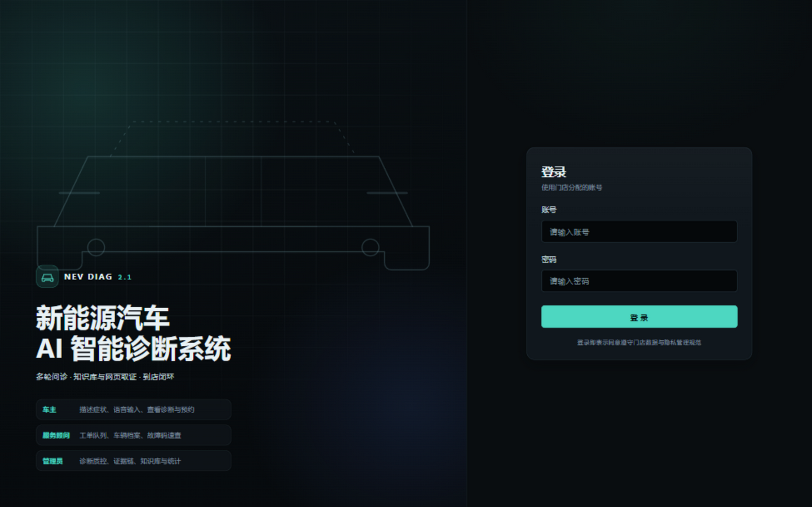

*图 3-1　登录页*

连续多次密码错误时，账号将被临时锁定一段时间以防暴力破解；锁定期间即使输入正确密码也无法登录，稍后自动解除。忘记密码时请联系管理员在成员管理中重置。

## 4. 车主端使用说明

### 4.1 车主端工作台

车主登录后进入车主端工作台，页面提供 AI 诊断、我的车辆、我的预约与设置等入口。工作台同时展示默认车辆、最近诊断与当前服务状态。车主端工作台如图 4-1 所示。

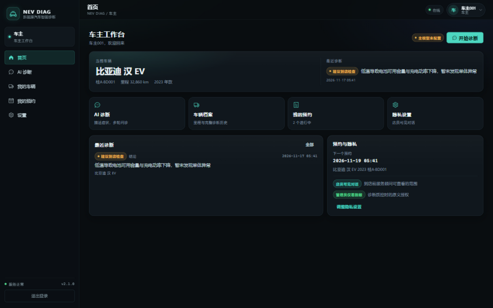

*图 4-1　车主端工作台*

### 4.2 AI 智能诊断对话

在 AI 诊断页，左侧为会话列表（可新建多个话题、搜索历史会话），中部为对话区，右侧为车辆上下文与当前诊断卡。首次进入时可直接在底部输入框描述车辆问题后点击「发送」；没有历史会话时系统会自动创建会话，不会丢失输入内容。对话页布局如图 4-2 所示。

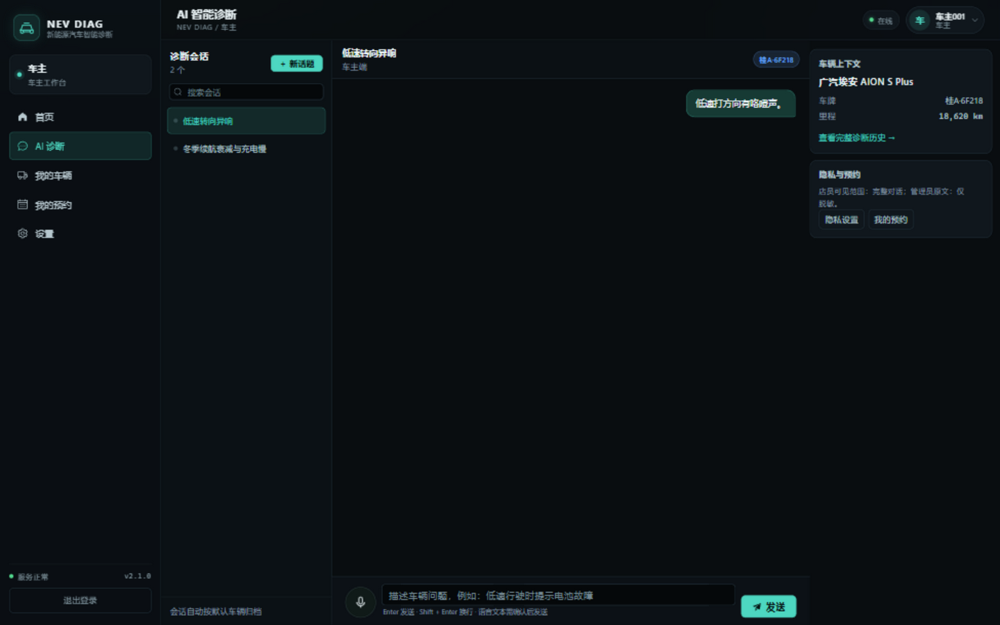

*图 4-2　AI 诊断对话页*

发送问题后，AI 自动读取车辆档案，并按需调用知识库检索、故障码查询与联网核实，查证过程以时间线形式实时展示，保证诊断结论有据可查。

当 AI 判断已有信息不足以给出可靠结论时，会以追问卡片列出补充问题：每个问题提供若干常见选项供点选，也支持手动输入；若无法确认，可选择「不知道 / 不清楚」，AI 将基于已有信息继续判断，不会卡住流程。

补充信息提交后，AI 继续分析并输出结构化诊断卡，内容包括：严重度标识（绿色正常、黄色注意、红色需检修）、结论概述、可能原因、建议检修步骤与仍需现场确认的事项；可能原因会关联 E1/E2… 证据编号，供管理员质控复核。诊断卡示例如图 4-3 所示。

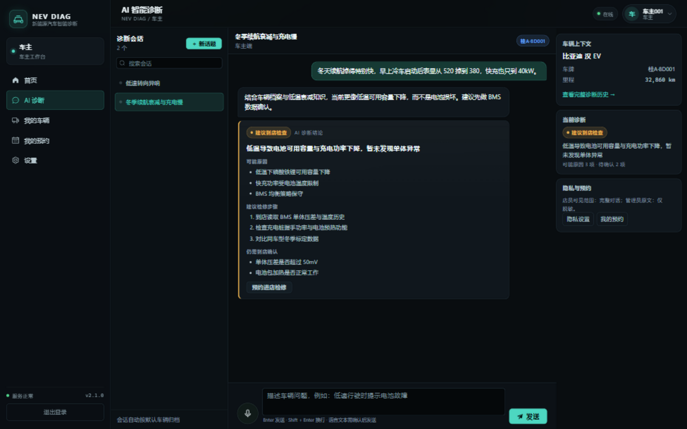

*图 4-3　结构化诊断卡*

诊断卡下方提供一键预约入口；点击后系统自动携带本次诊断摘要创建预约工单，无需重复描述车况。

**语音输入**：输入框左侧的麦克风按钮支持语音转文字。首次使用会展示录音隐私告知；点击开始录音，再次点击停止，识别文本会回填到输入框，需自行确认后发送。录音会发送到部署者配置的语音识别服务，系统不保存音频与识别文本；车内有乘客时请注意隐私。非 HTTPS 环境或浏览器不支持录音时，按钮不可用，可继续使用文字输入。

### 4.3 我的车辆

在我的车辆页可查看已登记的车辆信息（品牌车型、车牌、VIN 码、里程等）与历史诊断记录；支持添加、编辑车辆，维护里程。展开「最近诊断」的历史记录后，点击任一条目即可查看该次诊断的严重度、结论摘要、可能原因、检修步骤与待确认项。登记的车辆档案会在 AI 诊断时自动作为背景信息使用，默认车辆无需在对话中重复介绍。我的车辆页如图 4-4 所示。

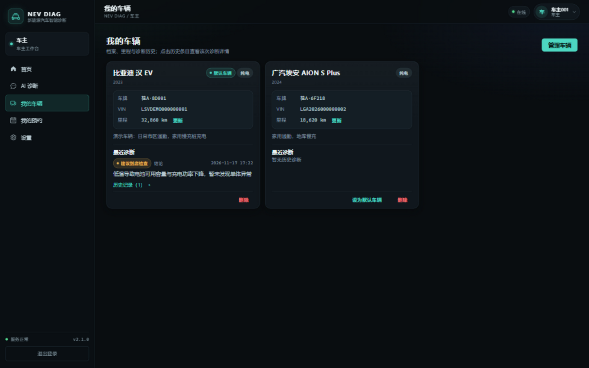

*图 4-4　我的车辆页*

### 4.4 我的预约

在我的预约页可查看全部预约记录及其当前状态（待接单、已接单、已完成、已取消），点击右上角「新建预约」可不经诊断直接创建预约。预约创建后由门店店员接单跟进，维修完成后可在店内打印诊断维修报告。我的预约页如图 4-5 所示。

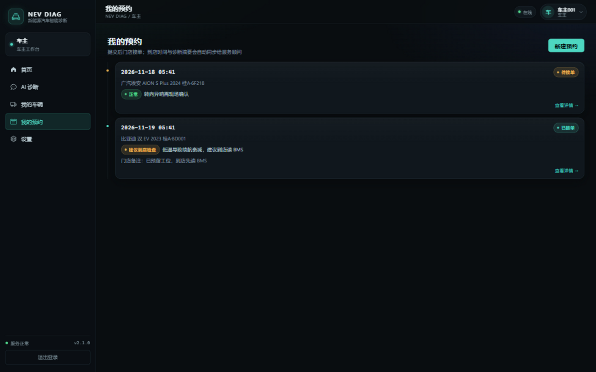

*图 4-5　我的预约页*

### 4.5 隐私设置、外观与修改密码

在设置页可进行隐私设置、外观切换与密码管理。「工作人员可见我的对话记录」开关默认开启：开启后，接待您的服务人员与诊断质控人员可查看本次诊断的完整对话过程，便于提前准备配件与质量复核；关闭后，工作人员仅能看到 AI 生成的诊断摘要卡（不含对话原文），后端对权限做强制校验。关闭后，该会话也不能被沉淀为案例。该开关可随时更改，对之后的诊断立即生效。设置页如图 4-6 所示。

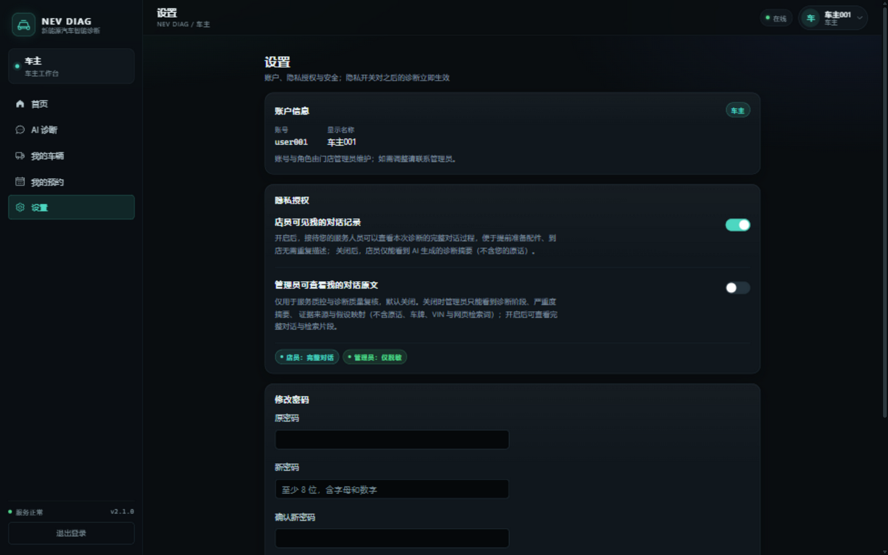

*图 4-6　设置页*

在「修改密码」区域输入原密码与新密码（至少 8 位，须同时包含字母和数字）后点击「保存新密码」完成修改。建议首次登录后立即修改初始密码。

「外观 → 界面主题」提供跟随系统（默认）、浅色、深色三档。跟随系统会随操作系统的深浅色设置自动切换；固定选择浅色或深色后不再随系统变化。偏好保存在账号上，换设备登录同样生效。

## 5. 店员端使用说明

### 5.1 预约工单处理

店员登录后进入预约工单页，可按状态筛选查看工单（全部、待接单、已接单、已完成、已取消），也可按关键词搜索。工单中展示车主诊断摘要（始终可见）与预约信息：对「待接单」工单可执行接单或改约；接单后按约定时间完成维修服务，并回填维修结果；回填完成后工单进入「已完成」状态，可一键将本次维修沉淀为案例。有新工单进入待接单队列时系统会自动提醒。工单列表如图 5-1 所示。

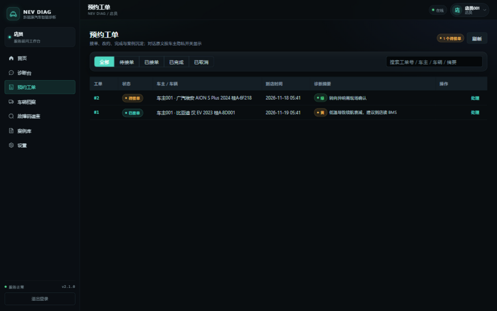

*图 5-1　预约工单页*

点击工单可打开详情抽屉，查看车主填写的预约信息、诊断摘要与对话原文（仅当车主开启「店员可见对话」）。详情抽屉如图 5-2 所示。

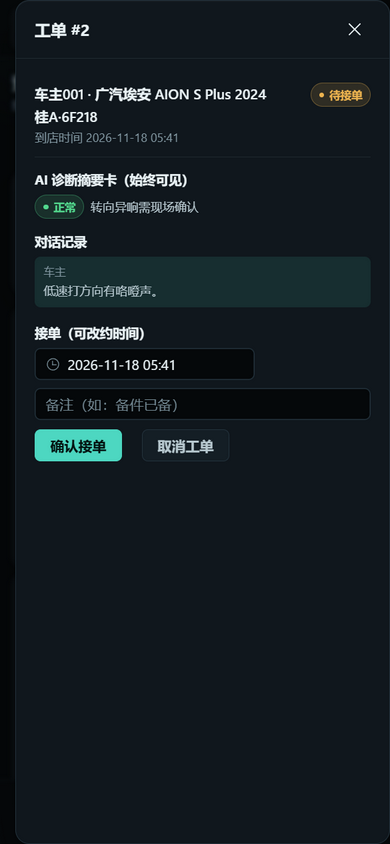

*图 5-2　工单详情抽屉*

### 5.2 车辆档案检索

在车辆档案检索页输入车牌、VIN 码或品牌车型关键字后点击「检索」，即可查看匹配的车辆档案、里程与最近诊断摘要；点击「历史」查看该车完整诊断历史（仅摘要/阶段，不含原文），点击「故障码」进入 DTC 速查。检索结果页如图 5-3 所示。

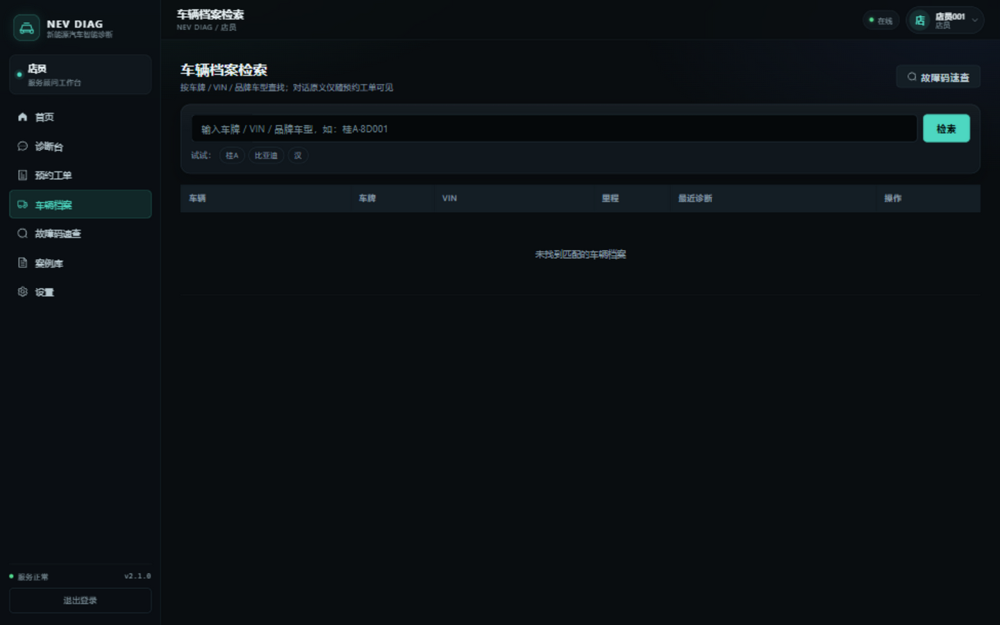

*图 5-3　车辆档案检索页*

### 5.3 DTC 故障码速查

DTC 速查页支持按故障码精确查询、按码前缀或中文名称模糊检索。输入 `P0A80`、`P0562`、`U0100` 等故障码后，系统展示码表定义、可能原因与维修提示；知识库无对应定义时，会提示该码可能为厂商专有码，并建议改用知识库检索。DTC 速查页如图 5-4 所示。

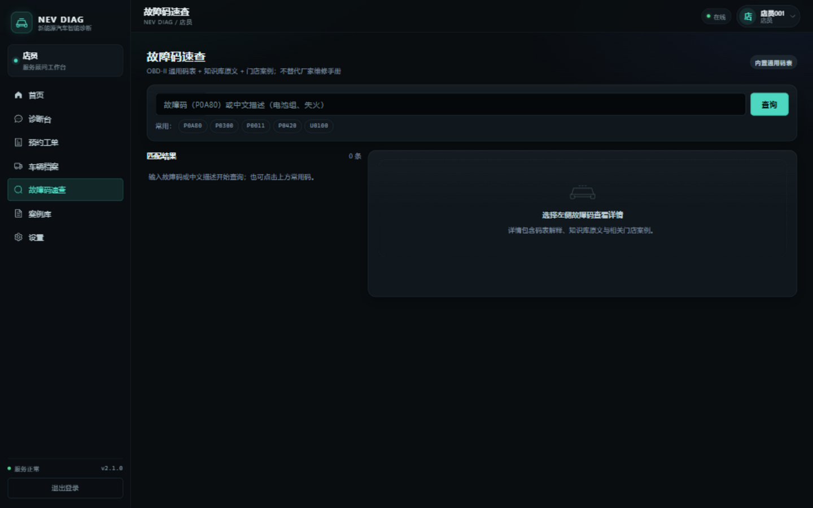

*图 5-4　DTC 故障码速查页*

### 5.4 案例库

案例库集中沉淀已完成的维修案例。工单完成后点击「沉淀案例」，系统自动将该次诊断与维修信息整理入库；沉淀的案例会纳入后续 AI 诊断的检索范围，使诊断结论能够参考本店真实维修经验。车主关闭对话可见开关时，系统拒绝沉淀（后端强制），案例库也不展示对话原文。案例库页如图 5-5 所示。

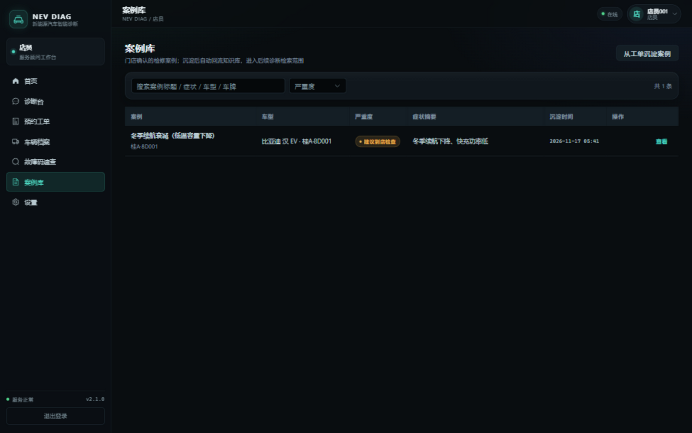

*图 5-5　案例库页*

### 5.5 诊断报告打印

在已完成的工单详情中可打开 HTML 版诊断维修报告，报告包含车辆信息、诊断结论、维修结果等内容，通过浏览器打印功能可直接另存为 PDF 或纸质打印交付车主。报告页如图 5-6 所示。

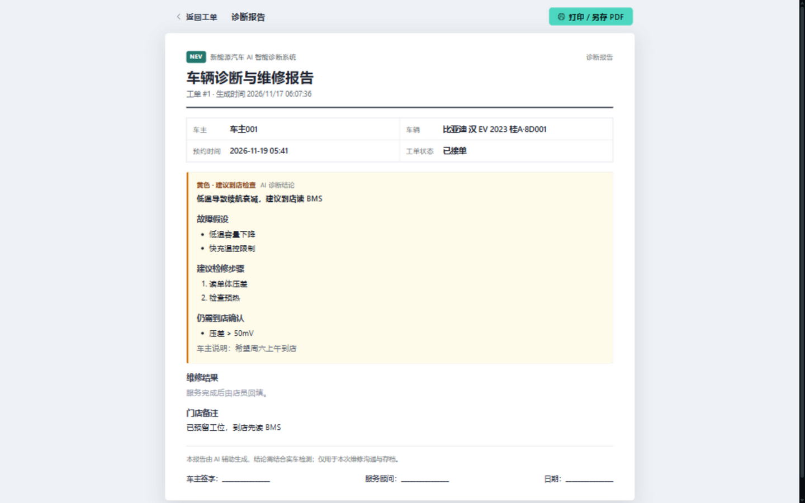

*图 5-6　诊断维修报告*

## 6. 管理端使用说明

### 6.1 统计看板

统计看板展示门店经营关键指标：模型用量（今日 / 近 7 天 / 近 30 天的调用次数与 Token 用量）、搜索/ASR 用量与成本估算、预约工单状态分布、沉淀案例数与在职账号数。统计看板如图 6-1 所示。

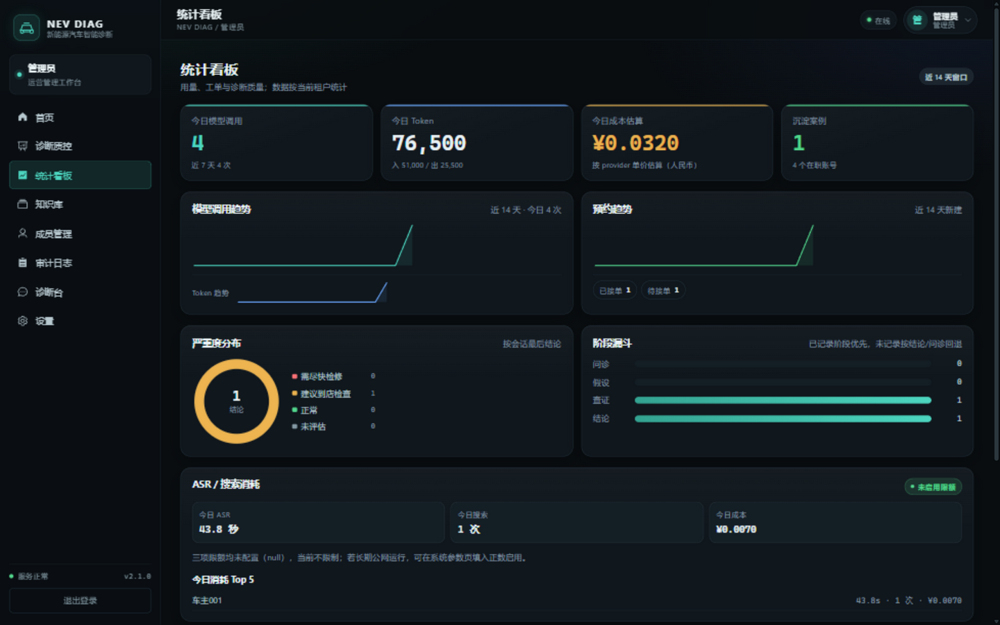

*图 6-1　统计看板*

### 6.2 成员与角色管理

在成员与角色管理页可查看全部账号（账号、姓名、角色、车辆、状态、最近登录），点击右上角「新建账号」创建成员，并通过每行的角色下拉框调整角色（车主 / 店员 / 管理员），支持停用账号、修改密码与重置密码操作。成员与角色管理页如图 6-2 所示。

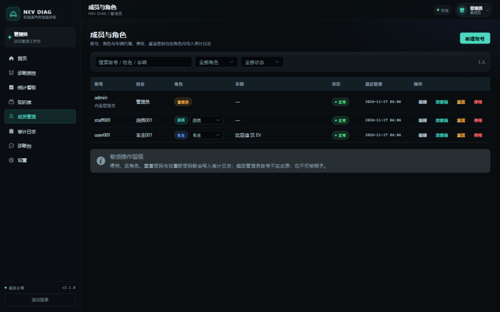

*图 6-2　成员与角色管理页*

### 6.3 知识库管理

知识库管理页提供检索测试台、文档预览与文档上传三项能力：检索测试台输入查询语句后可实测知识库召回效果，命中结果标注来源路径、得分与检索通道（向量 / 关键词）；文档预览支持按分类、模块浏览已入库知识；上传新文档支持 PDF、Word、Markdown、TXT、CSV、JSON 格式（单文件不超过 20 MiB），系统按文档标题结构自动分段入库，可填写来源说明以满足可溯源要求。知识库管理页如图 6-3 所示。

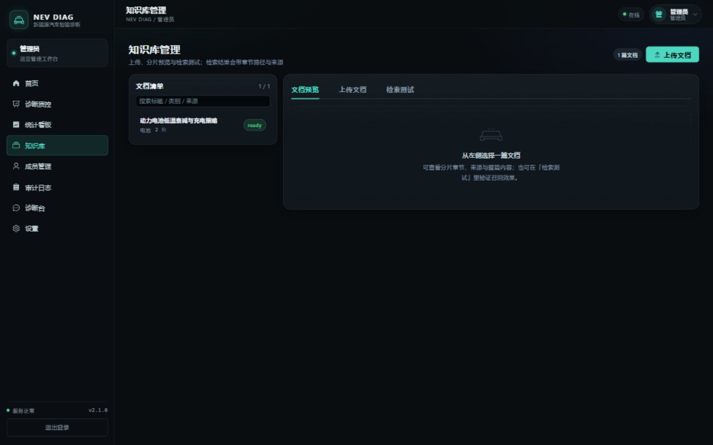

*图 6-3　知识库管理页（检索测试台）*

### 6.4 审计日志

审计日志完整记录登录成功、登录失败、账号锁定、新建账号、角色变更、密码修改、预约流转、隐私变更、案例沉淀、管理员查看诊断原文、ASR/搜索限额拒绝等关键操作，每条记录包含时间、操作人、动作、详情与来源 IP，支持按动作类型与操作人筛选。审计日志页如图 6-4 所示。

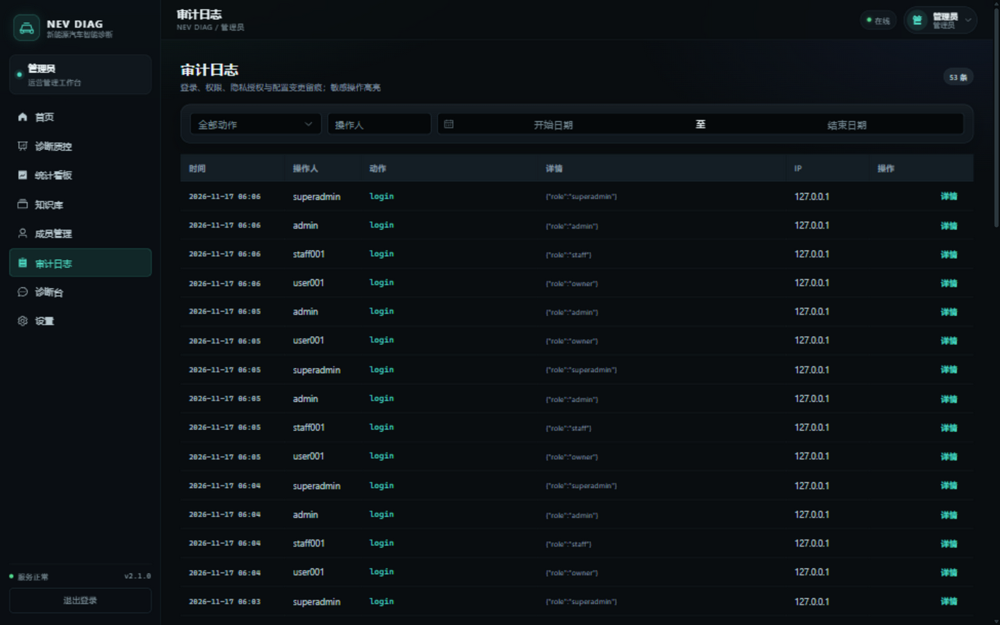

*图 6-4　审计日志页*

### 6.5 诊断质控

诊断质控页面向管理员复核 AI 诊断质量：可按阶段（接诊/假设/验证/结论）与严重度筛选会话，查看阶段时间线、假设列表与证据关联率；点击详情可查看诊断摘要、工具调用与证据链。对话原文默认不可见，仅当车主开启「工作人员可见我的对话记录」时展示，且每次查看写入审计。诊断质控页如图 6-5 所示。

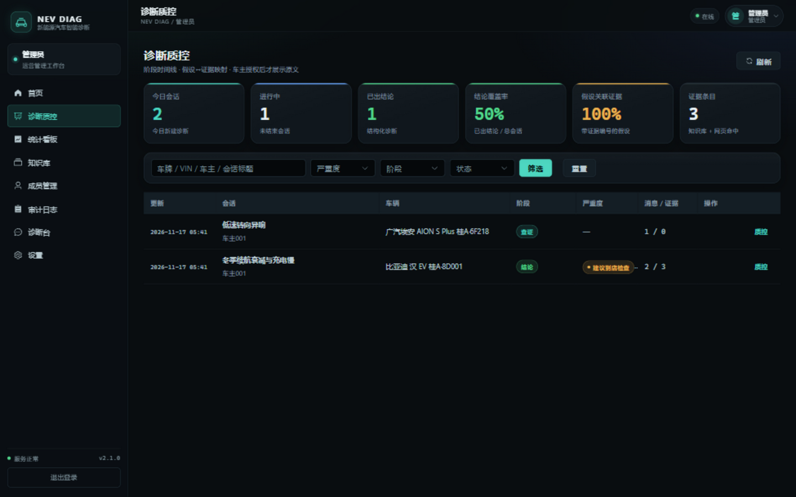

*图 6-5　诊断质控页*

## 7. 部署者调试后台

部署者调试后台（superadmin）面向系统部署与运维人员，与管理端相互隔离，仅部署者可访问，入口为 `/superadmin`。首次启动后端时系统自动创建 superadmin 账号并生成 20 位随机密码，**仅在首次生成时打印在后端进程启动终端**；之后从 `data/config.json` 读取，不再回显。遗忘密码时在服务器执行 `python main.py --reset-superadmin` 重新生成（旧密码立即作废）。后台页面如图 7-1 所示。

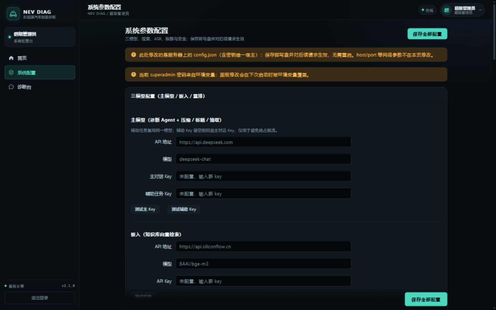

*图 7-1　部署者调试后台*

后台提供以下在线配置能力：

1. **模型服务**：主模型（含 `aux_key`，用于压缩/标题/抽取且可独立限流）、嵌入模型、重排模型的接口地址、模型名称与密钥（密钥单向掩码显示，留空即不修改），重排开关与分数阈值，每个槽位提供「测试连接」；
2. **联网检索**：DeepSeek / Tavily / 自定义供应商切换、失败/空结果降级开关、结果数与正文长度、各供应商地址/Key/超时，并可实测；
3. **语音识别**：DeepSeek / OpenAI 兼容供应商切换、最长录音秒数、最大字节数、地址/模型/Key/超时；
4. **限额**：每用户每日 ASR 秒数、搜索次数、全局每日预算（元）；留空或 0 表示不限制，填入正数后立即生效，清空立即恢复；
5. **智能体运行参数**：单轮最大工具调用轮数、追问上限、回复长度上限、采样温度、工具结果截断、上下文压缩策略、首轮强制检索。

所有配置保存后立即生效，无需重启服务（`server`/`security` 节除外）。Key 在接口中只返回掩码，不会下发前端明文。

## 8. 常见问题

1. **登录时提示账号被锁定**：15 分钟窗口内连续 5 次密码错误会触发临时锁定，锁定期间直接拒绝登录尝试，请稍后再试或联系管理员。
2. **AI 迟迟未回复或提示服务不可用**：请检查服务器到模型服务的网络连接与密钥配置；单次诊断的查证过程通常在数秒到数十秒内完成。页面上的错误编号可提供给部署者在后端日志中定位。
3. **诊断结论与实际车况不符**：AI 结论基于描述与知识库推断，诊断卡中的「仍需现场确认」事项请务必由维修技师实车检查确认。
4. **知识库检索结果不理想**：管理员可在知识库检索测试台实测召回；如召回不足，可补充上传相关维修文档，系统按文档结构自动分段入库。
5. **语音按钮不可用或识别失败**：语音识别需要 HTTPS（或 localhost）与浏览器麦克风权限；未配置 ASR 服务时按钮仍显示但会提示未配置，可直接使用文字输入。识别文本请自行确认后再发送。
6. **手机访问**：直接使用浏览器访问系统地址即可，页面自动适配手机屏幕；也可通过浏览器「添加到主屏幕」功能将系统添加为独立应用图标。
